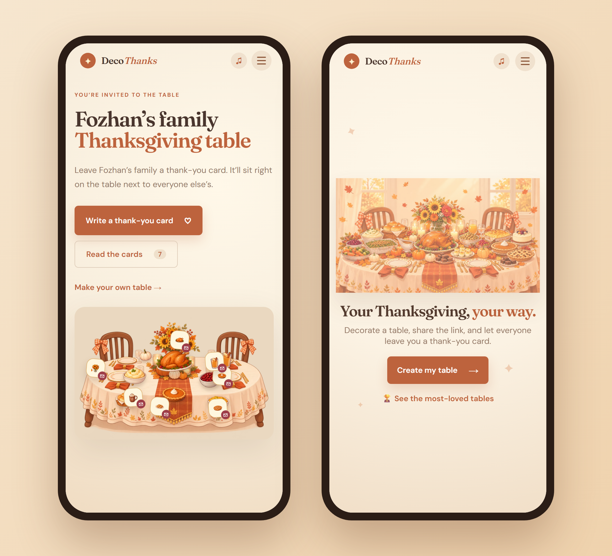

# DecoThanks 🦃

Decorate a Thanksgiving table, share the link, and let friends and family leave you thank-you cards.

**Live:** https://foojanbabaeeian.github.io/DecoMyThanksgivingTable/



- **Decorate** – drag 40+ hand-drawn dishes and decorations onto your table. Works on phones and desktops.
- **Share** – get a short link for group chats. Guests see your table and leave a card with a food sticker.
- **Unlock** – more pieces unlock as friends leave you cards (3, 5, 10 and 20 cards).
- **Leaderboard** – hosts can opt in to show their table on the most-loved tables board.
- **No accounts** – the browser that creates a table holds its private edit key.

## Run it locally

```bash
npm install
npm run dev          # http://localhost:5173
```

Without Supabase keys the app still works: share links carry a snapshot of the table, but cards don't sync between people.

To turn on syncing, create a free Supabase project, run [`supabase/schema.sql`](supabase/schema.sql) in its SQL Editor, then copy `.env.example` to `.env.local` and fill in the two values from **Project Settings → API**.

```bash
npm run check        # production build + smoke test (what CI runs)
```

## How it's built

| Piece | What |
|---|---|
| Front end | Plain JavaScript + CSS, bundled with [Vite](https://vitejs.dev). Everything lives in `src/main.js` and `src/style.css`. |
| Data | [Supabase](https://supabase.com) Postgres. Row Level Security plus three `security definer` functions mean only a table's creator can edit it, while anyone with the link can read it and leave a card. See `supabase/schema.sql`. |
| Art | `public/assets/foods/<category>/*.png` |
| Hosting | GitHub Pages by default; optionally your own server behind Cloudflare. Both deploy from GitHub Actions after the tests pass. See [docs/DEPLOY.md](docs/DEPLOY.md). |

## Contributing

Contributions are welcome! Read [CONTRIBUTING.md](CONTRIBUTING.md), then pick an issue labelled **good first issue**.

## License

[MIT](LICENSE)
